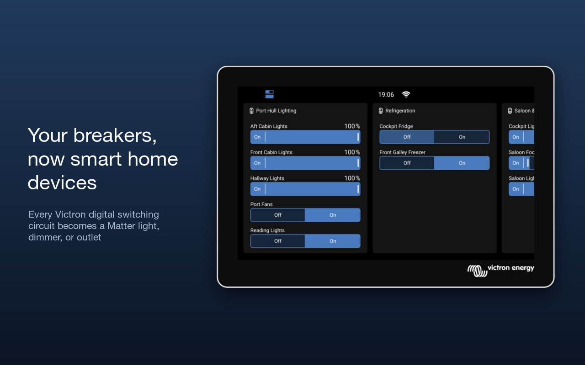
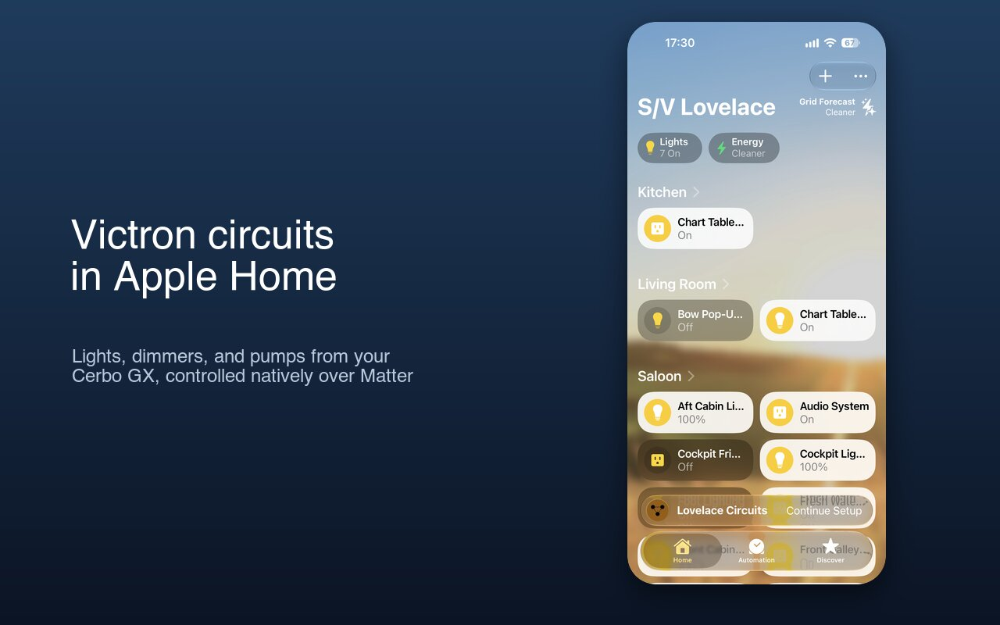

# signalk-venus-matter

A Signal K plugin that advertises Victron digital switching circuits (lights, dimmers, pumps, and so on) as **Matter** devices on your boat's network. iPhones, iPads, and Android devices can then control them natively from Apple Home, Google Home, or any other Matter controller.




## What it does

1. Connects directly to your Cerbo GX (or other Venus OS device) over its local MQTT broker and discovers every digital switching output, on any number of switching modules
2. Runs a Matter **bridge** on the local network and adds one bridged device per output:
   - outputs set to **Dimmable** on the GX become **dimmable lights**
   - **Toggle** outputs whose name looks like lighting become **on/off lights**
   - all other toggle outputs (pumps, fridges, fans, electronics) become **outlets**
   - **Momentary** outputs (horns, windlass, etc.) can be turned on per circuit. Turning one on in a Matter app gives a 0.5 second press. They are off by default, so exposing them to phone apps and home automations is a deliberate choice
   - outputs hidden in the Victron UI, and other types (sliders, dropdowns, etc.), are skipped
3. Keeps state in sync both ways. Changes on the GX show up in the Home app, and changes in the Home app are written straight to the GX
4. Uses the names you've set on the GX, and keeps working if you rename a circuit
5. Follows changes on the GX live. A circuit you hide or retype on the GX is removed or rebuilt. A circuit on a switching module that goes offline shows as "No Response" until the module is back

## Requirements

- A Victron GX device (Cerbo GX, etc.) with digital switching outputs, with **MQTT access enabled** and reachable from the Signal K server
- Node.js 20.19+ (Node 20) or 22.13+ — the range matter.js supports. A Cerbo GX running Venus OS Large ships Node 20
- A Matter controller on the same network (for example an Apple Home hub, which can be an Apple TV or HomePod, for remote access in Apple Home)
- The Signal K server must be reachable from the controller over IPv6 link-local and mDNS. This is the normal case on a single LAN.

## Installation

Install through the Signal K AppStore, or manually:

```bash
cd ~/.signalk
npm install signalk-venus-matter
```

Restart the Signal K server, then enable the plugin in **Server → Plugin Config**.

## Setup and pairing

Open **Server → Plugin Config → Matter Bridge for Victron Switching**. The plugin has its own configuration panel:

1. **GX Device:** enter your Cerbo GX's IP address and save. If you use the Victron Venus plugin, you can leave it blank, and the address from that plugin's settings is used. The plugin restarts, connects to the GX, and a green "Connected" indicator appears. Only fill in the MQTT port, TLS, and username/password if your GX's security settings require them.
2. **Pairing:** the panel shows a QR code and an 11-digit setup code. In Apple Home, choose **Add Accessory** and scan the QR code, or tap **More options** and enter the code. Google Home and other Matter apps work the same way. Accept the "uncertified accessory" warning, because the bridge uses the Matter test vendor ID.
3. **Circuits:** every output on the GX is listed by switching module. For each circuit you can:
   - rename it (leave blank to use the name from the GX),
   - change how it appears: **Auto**, **On/off light**, **Dimmable light** (dimmable outputs only), or **Outlet / switch**,
   - turn it on or off in Matter with **Show in Matter** (momentary outputs start turned off).

   Faults reported by the GX (tripped, over temperature, short circuit) and offline modules are shown in red. Outputs that can't be bridged, such as hidden ones, are shown greyed out with the reason.
4. **Matter Bridge:** the bridge name shown while pairing, and the Matter port (default `5540`).

Click **Save Configuration** to apply. The plugin restarts, and paired apps keep working.

Once paired, the panel shows **Paired with:** and the apps the bridge is paired with. Apple Home shows up twice, as "Apple Home (<your home name>)" and "Apple"; that's normal. To add the bridge to a second app, use the "Turn On Pairing Mode" option for the bridge in an app it's already paired with.

### Starting over

If you remove the bridge from the Home app, the bridge doesn't always find out, and it keeps showing **Paired** with no QR code. To start over:

1. Remove the bridge from every app it's paired with.
2. In the panel, click **Reset pairing**, then click again to confirm.

This forgets every pairing and generates a new bridge identity and QR code. Any app that still has the old bridge will show it as "No Response" until you remove it there.

## License

ISC
